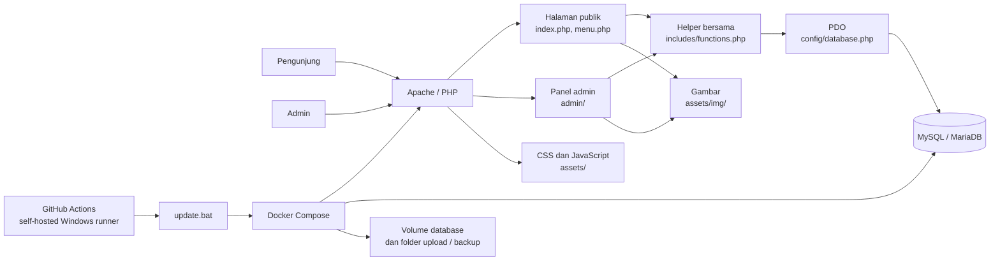

# Arsitektur Moma Bread

Dokumen ini menggambarkan arsitektur aplikasi yang ada saat ini, bukan target
arsitektur masa depan. Untuk setup dan daftar fitur, lihat
[`README.md`](README.md); untuk perubahan yang direncanakan, lihat
[`ROADMAP.md`](ROADMAP.md).

## Gambaran sistem

## Komponen aplikasi

### Halaman publik

- [`index.php`](index.php) merender landing page dan bagian-bagian konten yang
  aktif dari database.
- [`menu.php`](menu.php) merender jenis roti untuk kategori yang dipilih.
  URL kategori dapat memakai rewrite Apache atau query string, bergantung pada
  `PRETTY_MENU_URL`.
- [`includes/header.php`](includes/header.php) dan
  [`includes/footer.php`](includes/footer.php) menyediakan layout bersama.
- [`assets/css/style.css`](assets/css/style.css) dan
  [`assets/js/main.js`](assets/js/main.js) menangani tampilan dan interaksi
  browser seperti navigasi mobile, tema, dan lightbox. Pada viewport mobile,
  drawer navigasi menggunakan tinggi layar penuh dan dapat digulir; efek
  `backdrop-filter` header dinonaktifkan agar tidak membatasi area drawer.

### Panel admin

- File halaman berada di `admin/`; autentikasi dan operasi admin dilakukan
  dalam request PHP biasa.
- [`admin/_schema.php`](admin/_schema.php) mendefinisikan entitas dan field
  untuk CRUD generik di `admin/manage.php`.
- [`admin/settings.php`](admin/settings.php) mengelola pengaturan situs;
  halaman backup dan status server berada di `admin/`.

### Lapisan bersama dan data

- [`includes/functions.php`](includes/functions.php) menyediakan helper
  keamanan, query, pengaturan, URL, gambar, dan WhatsApp.
- [`config/database.php`](config/database.php) membuat koneksi PDO. Konfigurasi
  lokal berada di `config/config.php`, yang tidak boleh masuk Git; template
  aman repository berada di `config/config.example.php`.
- Query aplikasi menggunakan prepared statements PDO. Placeholder query adalah
  positional `?`.
- Konten katalog, pengaturan situs, dan akun admin disimpan di MySQL/MariaDB.
  Gambar bawaan dan gambar yang diunggah dilayani sebagai file statis.

### File statis dan unggahan

- CSS, JavaScript, logo, dan gambar bawaan berada di `assets/`.
- Path gambar upload disimpan sebagai nilai relatif ke `assets/img/`.
- Saat deployment Docker, database bertahan di named volume Compose; folder
  upload dan backup dipasang sebagai bind mount dari host Windows.
- Backup bukan pengganti retensi eksternal. Ikuti panduan deploy untuk
  menyimpan salinan di luar server.

## Alur request

1. Browser meminta halaman publik atau admin ke Apache.
2. Halaman PHP memuat helper dan konfigurasi database yang diperlukan.
3. Halaman membaca atau mengubah data melalui PDO dan helper query.
4. PHP merender HTML; browser mengambil CSS, JavaScript, dan file gambar.
5. Aksi pemesanan membuka WhatsApp melalui URL `wa.me`; pemesanan tidak
   diproses atau disimpan oleh aplikasi.

## Alur deployment Docker

1. Push ke branch `main` memicu
   [workflow GitHub Actions](.github/workflows/deploy-docker.yml).
2. Self-hosted Windows runner memanggil `update.bat` pada server.
3. Script memperbarui working copy dan menjalankan Docker Compose.
4. Container web PHP/Apache berkomunikasi dengan MariaDB pada jaringan internal
   Compose; database tidak perlu diekspos sebagai port publik.
5. Database, upload, dan backup menggunakan penyimpanan persisten di luar
   container agar dapat bertahan saat container dibuat ulang.

Panduan operasional lengkap ada di
[`DEPLOY-DOCKER.md`](DEPLOY-DOCKER.md) dan
[`DEPLOY-TZSERVER.md`](DEPLOY-TZSERVER.md).

## Batas dan keputusan arsitektur saat ini

- Aplikasi adalah monolit PHP tanpa framework dan tanpa API/service terpisah.
- Request halaman dan operasi CRUD berjalan sinkron; tidak ada worker atau
  antrean pekerjaan khusus yang dikonfigurasi.
- Tidak ada Composer atau test runner otomatis yang dikonfigurasi saat ini.
- Tidak ada sistem migrasi database khusus yang teridentifikasi; perubahan
  skema perlu mempertimbangkan database yang sudah berisi data.
- Data konten ada di database, sedangkan file gambar berada di filesystem.
  Proses backup dan pemulihan perlu mencakup keduanya.
